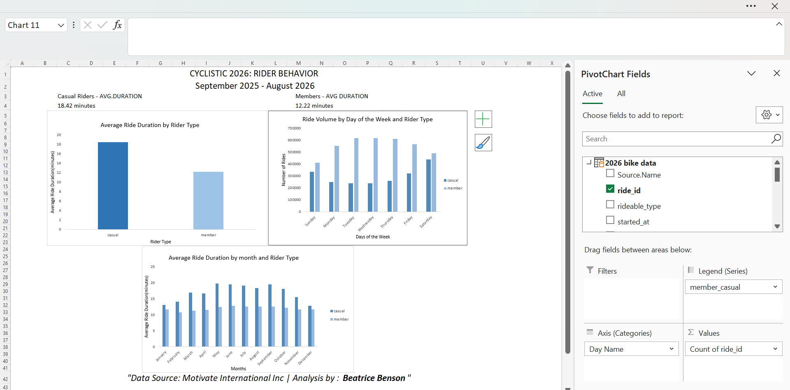
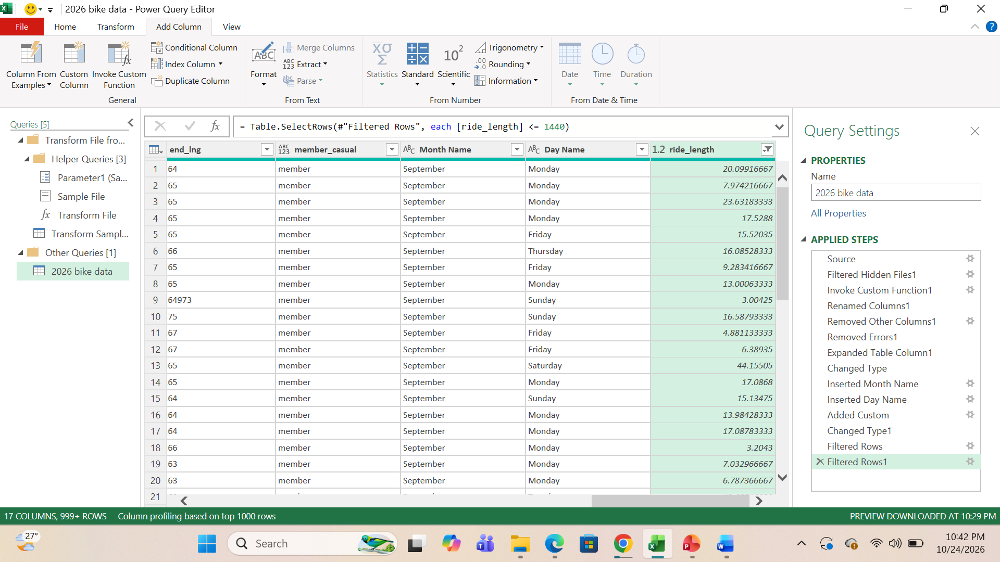
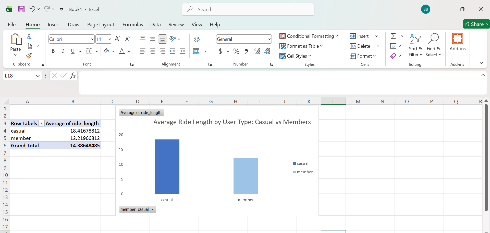
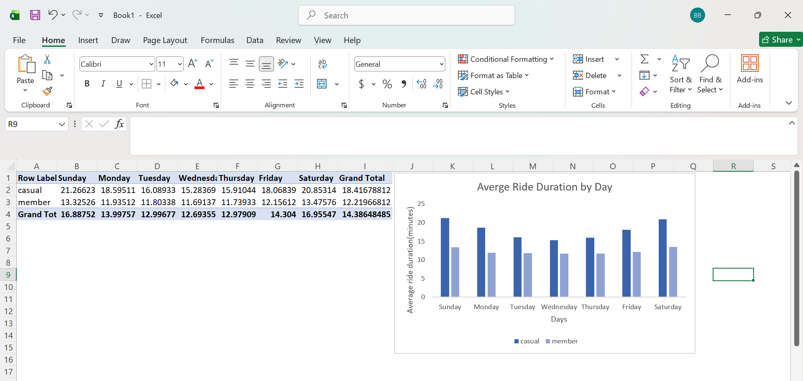
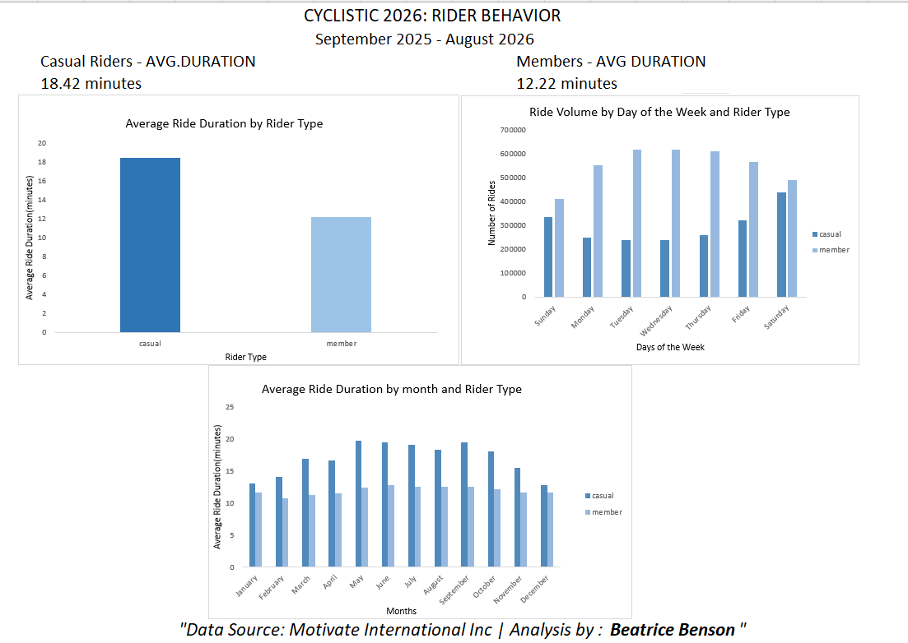

# Cyclistic Bike-Share Case Study: Understanding Rider Behavior


## Project Overview


This project analyzes bike-share trip data to understand how casual riders and annual members use the service differently. It is based on the Cyclistic case study from the Google Data Analytics Professional Certificate.

In the case study, Cyclistic is a fictional bike-share company operating in Chicago. The business objective is to increase annual memberships by understanding casual riders' behavior and identifying opportunities to encourage them to become members.

For this analysis, I used 12 months of Divvy trip data, covering **September 2025 to August 2026**, to explore differences in ride duration and riding patterns between casual riders and members.

**Tools used:** Microsoft Excel, Power Query, PivotTables, and PivotCharts.

**Project period:** September 2025 – August 2026.


This case study follows the six step data analysis process,❓Ask, 📓Prepare, 🛠️Process, 📈Analyze, 📢Share, 🚴Act.

## Table of Contents

1. [Ask](#1-ask)
2. [Prepare](#2-prepare)
3. [Process](#3-process)
4. [Analyze](#4-analyze)
5. [Share](#5-share)
6. [Act](#6-act)
7. [Limitations](#limitations)
8. [Data Source and References](#data-source-and-references)

---

## 1. Ask

### Business Scenario

Cyclistic's marketing team wants to increase annual memberships. The team believes that understanding the differences between casual riders and annual members can help develop marketing strategies that encourage casual riders to subscribe to annual memberships.

### Business Task

Analyze historical bike-share trip data to identify differences in how casual riders and annual members use the service. Use these findings to recommend data-informed marketing strategies that could encourage casual riders to become annual members.

### Key Business Questions

- How does average ride duration differ between casual riders and annual members?
- How does ride duration vary across the days of the week for each rider type?
- How does ride volume differ between casual riders and members across the week?
- What marketing opportunities could these patterns suggest?

### Stakeholders

- **Primary Stakeholders:** Lily Moreno, the director of the marketing team and the Cyclistic Executive team.
- **Secondary Stakeholders:** Marketing team, analyzes rider behavior and communicates evidence to support business decisions.


### Deliverable: Excel Dashboard and Analytical Report

I developed an Excel dashboard and written analysis to communicate the key findings from the Cyclistic bike-share case study. Using Excel Power Query, PivotTables, and PivotCharts, I analyzed trip data from September 2025 to August 2026 to compare ride duration and weekly riding patterns between casual riders and annual members.

The analysis identified differences in average ride duration, with casual riders averaging 18.42 minutes per trip compared with 12.22 minutes for annual members. I used these findings, together with the day-of-week analysis, to develop practical recommendations for testing targeted marketing strategies aimed at encouraging casual riders to consider annual memberships.

The dashboard below presents the main visualizations used to communicate the results.



---

## 2. Prepare

### Data Source

The analysis used historical Divvy bike-share trip data made publicly available by Motivate International Inc.

- [Divvy Trip Data](https://divvy-tripdata.s3.amazonaws.com/index.html)

- [License Agreement](https://www.divvybikes.com/data-license-agreement)


The selected reporting period covers September 2025 to August 2026.

The downloaded data consisted of 12 monthly CSV files. The combined dataset contained approximately 6.1 million rows and 17 columns, according to my initial data inventory.

### Data Structure

The dataset contains trip-level information, including:

- Ride identifier
- Bike type
- Trip start and end timestamps
- Start and end station information
- Station coordinates
- Rider type (`member_casual`)

These fields support analysis of ride duration, rider type, and usage patterns across different days of the week.

### Data Credibility: ROCCC Framework

I considered the data using the ROCCC framework: Reliability, Originality, Comprehensiveness, Currency, and Citation.

- **Reliability:** The data includes complete and accurate ride data from Divvy. Divvy is a program of the Chicago Department of Transportation (CDOT), which owns the city's bikes, stations and vehicles. 
- **Originality:** The data is from Motivate International Inc, which operates the City of Chicago's Divvy bike sharing service.
- **Comprehensiveness:** The data includes types of bikes, start and end station name, start and end time, station ID, station longitude and latitude, and membership types.
- **Current:** The data is up to date August 2026
- **Citation:** The data is cited and under license agreement.


### Data Privacy

The published trip data is anonymized. This project analyzes trip-level usage patterns rather than attempting to identify individual riders.

---

## 3. Process

### Tool Used: Excel Power Query

I used Excel Power Query to combine and prepare the 12 monthly CSV files for analysis. The workflow involved the following stages.

**Step 1: Combine monthly files**

Imported the monthly CSV files from the source folder and appended them into a single dataset using Power Query.

**Step 2: Convert data types**

Converted `started_at` and `ended_at` to Date/Time data types. Rows with timestamps that could not be parsed were removed from the analysis.

**Step 3: Calculate ride duration**

Created a custom column called `ride_length` to calculate the difference between the trip end and start timestamps in minutes:

```powerquery
Duration.TotalMinutes([ended_at] - [started_at])
```

**Step 4: Create time-based variables**

Added month and day-of-week variables to support comparisons of riding patterns over time.

**Step 5: Filter ride durations**

Removed rides shorter than one minute and rides longer than 24 hours. These filters were applied to reduce the influence of potentially invalid or unusually long trips on average-duration calculations.


### Data Cleaning

The image below demonstrates the data cleaning workflow. 



### Data Quality Checks

The processing stage focused on timestamp validity, ride-duration calculation, and filtering. For a meaningful analysis, I checked the final dataset for duplicate ride identifiers, negative durations, missing rider categories, and consistency across the monthly files.

---

## 4. Analyze

I used Excel PivotTables and PivotCharts to compare average ride duration and ride volume between casual riders and annual members.

### 4.1 Overall Ride Duration

The initial descriptive results for the cleaned dataset were:

| Metric | Results |
|---|---:|
| Overall mean ride duration | 14.4 minutes |
| Maximum ride duration | 1,439.98 minutes |


### 4.2 Average Ride Duration by Rider Type



**Findings:** Casual riders had an average ride duration of 18.42 minutes, compared with 12.22 minutes for annual members.This means the average casual ride was approximately 51% longer than the average member ride.

**Interpretation:** Casual riders and annual members demonstrate different average trip durations. This difference provides a useful starting point for further investigation into their needs and potential membership preferences. Ride duration alone, however, does not establish why a person rides or whether the trip is for leisure or commuting.

### 4.3 Average Ride Duration by Day of the Week 



**Findings:** The day-of-week chart indicates that casual riders tend to have longer average rides on weekends, while member ride durations appear more consistent throughout the week.

**Interpretation:** If this pattern is confirmed in the underlying data, weekends may provide a useful opportunity to communicate the benefits of annual membership to casual riders. The marketing team should consider this alongside ride volume, membership pricing, and additional customer research.

### 4.4 Ride Volume by Day of the Week


**Findings:** The data reveals distinct usage pattens. Annual members account for a significantly higher volume of rides during the weekdays. Casual riders volume peak on Saturdays and Sundays. 

**Interpretation**This suggests that annual members use the service for regular commuting while casual riders use bikes for leisure and other weekend activities.


### Key Findings Summary

Based on the results currently available:

1. Casual riders have a higher reported average ride duration than annual members.
2. The day-of-week duration analysis suggests that casual riders' rides are longer on weekends.
3. Ride volume by day of the week can provide additional evidence about when each rider group uses the service.
4. These differences can inform marketing hypotheses, but further research is needed to establish why casual riders choose their current plans and what would motivate them to subscribe.

---

## 5. Share

### Excel Dashboard: Cyclistic Rider Behavior

The analysis was consolidated into an Excel dashboard to communicate the findings clearly to the marketing team and executive stakeholders.




- **Average ride duration by rider type:** Compares typical trip duration between casual riders and members.
- **Ride volume by day of the week:** Compares the number of trips made by each group throughout the week.
- **Average ride duration by day of the week:** Shows how the duration difference changes across the week.

---

## 6. Act

**Conclusions based on the analysis.**

- Casual riders ride mostly on weekends.
  
- Casual riders ride longer duration, but least total trips.

- Most active months for casual riders are from May to September.

Marketing recommendations to convert casual riders into annual members.

 **1.Introduce Targeted Weekend Membership Campaigns:** The company should consider targeting membership campaigns during periods of high casual-rider activity, particularly on Saturdays.  Campaign messages should communicate the convenience, flexibility and potential value of annual membership to frequent casual users.
 

**2.Conduct Customer Research to Understand Membership Barriers:** short customer surveys, interviews or feedback to understand the factors influencing membership decisions. Research should explore on perceived membership costs, frequency of bike usage, convenience, benefits from the annual subscriptions.


**3. Match Campaign Timing to Ride Volume:** Use the ride-volume findings to select campaign periods. Test digital messages before or during periods when the casual-rider activity is high. 


**4. Measure the campaign performance:** Conduct a pilot campaign and compare its results with a suitable baseline or comparison group.

---

## Limitations

This analysis has several limitations:

- Trip records describe observed usage but do not directly reveal a rider's purpose, preferences, income, or reason for choosing a membership plan.
  
- Average ride duration can be influenced by unusually long trips and by the duration filters applied during cleaning.
  
- The findings cover September 2025 to August 2026 and may not represent all future periods.
  
- Ride-level records should not automatically be interpreted as unique customers; one person may make multiple trips.


Further research, including customer surveys and a measured marketing pilot, would help determine which interventions are most effective.

---

## Data Source and References

Motivate International Inc. (n.d.). [Divvy Trip Data](https://divvy-tripdata.s3.amazonaws.com/index.html)

Divvy Bikes. (n.d.). [Data License Agreement](https://www.divvybikes.com/data-license-agreement)

Google Data Analytics Professional Certificate. (n.d.). Cyclistic bike-share case study: How does a bike-share navigate speedy success? Google/Coursera case study materials.

---

## Project Summary

This project demonstrates an end-to-end data analytics workflow using Excel Power Query, PivotTables, and PivotCharts. It combines, cleans, and analyzes bike-share trip records to compare rider behavior and translate the findings into testable marketing recommendations.


