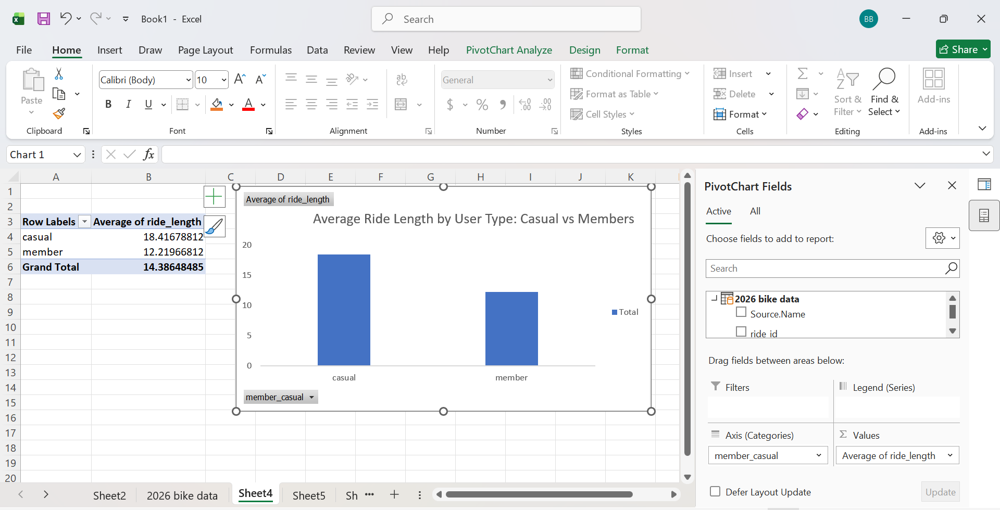
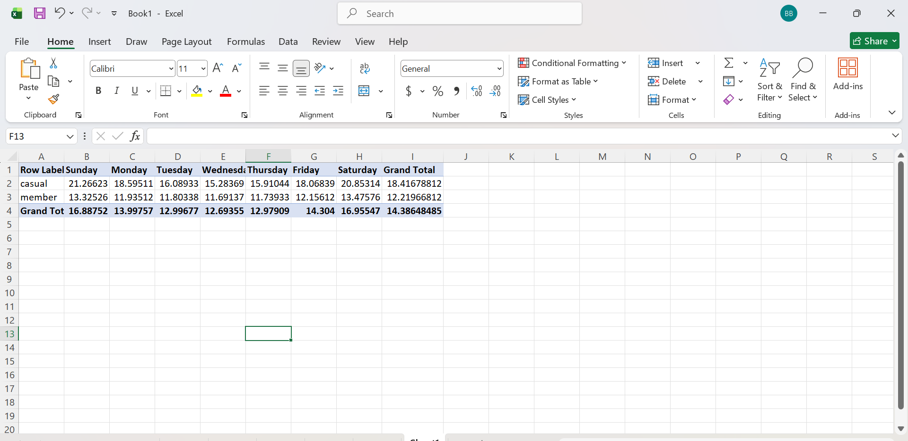

# Cyclistic Bike-Share Case Study: Understanding Rider Behavior

## Project Overview

This project analyzes bike-share trip data to understand how casual riders and annual members use the service differently. It is based on the Cyclistic case study from the Google Data Analytics Professional Certificate.

In the case study, Cyclistic is a fictional bike-share company operating in Chicago. The business objective is to increase annual memberships by understanding casual riders' behavior and identifying opportunities to encourage them to become members.

For this analysis, I used 12 months of Divvy trip data, covering **September 2025 to August 2026**, to explore differences in ride duration and riding patterns between casual riders and members.

**Tools used:** Microsoft Excel, Power Query, PivotTables, and PivotCharts.

**Project period:** September 2025 – August 2026.

## Table of Contents

1. [Ask](#1-ask)
2. [Prepare](#2-prepare)
3. [Process](#3-process)
4. [Analyze](#4-analyze)
5. [Share](#5-share)
6. [Act](#6-act)
7. [Limitations](#limitations)
8. [Data Source and References](#data-source-and-references)

---

## 1. Ask

### Business Scenario

Cyclistic's marketing team wants to increase annual memberships. The team believes that understanding the differences between casual riders and annual members can help develop marketing strategies that encourage casual riders to subscribe to annual memberships.

### Business Task

Analyze historical bike-share trip data to identify differences in how casual riders and annual members use the service. Use these findings to recommend data-informed marketing strategies that could encourage casual riders to become annual members.

### Key Business Questions

- How does average ride duration differ between casual riders and annual members?
- How does ride duration vary across the days of the week for each rider type?
- How does ride volume differ between casual riders and members across the week?
- What marketing opportunities could these patterns suggest?

### Stakeholders

- **Director of Marketing, Lily Moreno:** Uses the findings to inform marketing campaigns.
- **Cyclistic Executive Team:** Reviews and makes decisions about proposed marketing initiatives.
- **Marketing Analytics Team:** Analyzes rider behavior and communicates evidence to support business decisions.

### Deliverable


### Deliverable: Excel Dashboard and Analytical Report

I developed an Excel dashboard and written analysis to communicate the key findings from the Cyclistic bike-share case study. Using Excel Power Query, PivotTables, and PivotCharts, I analyzed trip data from September 2025 to August 2026 to compare ride duration and weekly riding patterns between casual riders and annual members.

The analysis identified differences in average ride duration, with casual riders averaging 18.42 minutes per trip compared with 12.22 minutes for annual members. I used these findings, together with the day-of-week analysis, to develop practical recommendations for testing targeted marketing strategies aimed at encouraging casual riders to consider annual memberships.

The dashboard below presents the main visualizations used to communicate the results.


An Excel dashboard and written analysis presenting the key findings and practical recommendations for encouraging casual riders to consider annual memberships.

---

## 2. Prepare

### Data Source

The analysis uses historical Divvy bike-share trip data made publicly available by Motivate International Inc.

- [Divvy Trip Data](https://divvy-tripdata.s3.amazonaws.com/index.html)
- [Divvy Data License Agreement](https://www.divvybikes.com/data-license-agreement)

The selected reporting period covers September 2025 to August 2026.

The downloaded data consisted of 12 monthly CSV files. The combined dataset contained approximately 6.1 million rows and 14 columns, according to my initial data inventory.

### Data Structure

The dataset contains trip-level information, including:

- Ride identifier
- Bike type
- Trip start and end timestamps
- Start and end station information
- Station coordinates
- Rider type (`member_casual`)

These fields support analysis of ride duration, rider type, and usage patterns across different days of the week.

### Data Credibility: ROCCC Framework

I considered the data using the ROCCC framework: Reliability, Originality, Comprehensiveness, Currency, and Citation.

- **Reliability:** The data provides recorded trip details suitable for examining bike-share usage. Data types, timestamps, and calculated durations were checked during processing. However, the dataset should not be assumed to be error-free.
- **Originality:** The records originate from the Divvy trip-data source published by Motivate International Inc.
- **Comprehensiveness:** The dataset contains trip timestamps, rider categories, bike types, and station-related fields. Missing station information or other incomplete records may still affect some analyses.
- **Currency:** The selected data covers September 2025 through August 2026, making it relevant to the stated reporting period.
- **Citation:** The data source and applicable license are provided above.

### Data Privacy

The published trip data is anonymized. This project analyzes trip-level usage patterns rather than attempting to identify individual riders.

---

## 3. Process

### Tool Used: Excel Power Query

I used Excel Power Query to combine and prepare the 12 monthly CSV files for analysis. The workflow involved the following stages.

**Step 1: Combine monthly files**

Imported the monthly CSV files from the source folder and appended them into a single dataset using Power Query.

**Step 2: Convert data types**

Converted `started_at` and `ended_at` to Date/Time data types. Rows with timestamps that could not be parsed were removed from the analysis.

**Step 3: Calculate ride duration**

Created a custom column called `ride_length` to calculate the difference between the trip end and start timestamps in minutes:

```powerquery
Duration.TotalMinutes([ended_at] - [started_at])
```

**Step 4: Create time-based variables**

Added month and day-of-week variables to support comparisons of riding patterns over time.

**Step 5: Filter ride durations**

Removed rides shorter than one minute and rides longer than 24 hours. These filters were applied to reduce the influence of potentially invalid or unusually long trips on average-duration calculations.

The duration filters are analytical decisions; they do not prove that every excluded trip was a false start, lost bike, or stolen bike.

### Data Cleaning Evidence

The following image documents part of the Power Query workflow:


### Data Quality Checks

The processing stage focused on timestamp validity, ride-duration calculation, and filtering. For a reproducible analysis, the final dataset should also be checked for duplicate ride identifiers, negative durations, missing rider categories, and consistency across the monthly files.

---

## 4. Analyze

I used Excel PivotTables and PivotCharts to compare average ride duration and ride volume between casual riders and annual members.

### 4.1 Overall Ride Duration

The initial descriptive results reported for the cleaned dataset were:

| Metric | Reported result |
|---|---:|
| Overall mean ride duration | 14.4 minutes |
| Maximum ride duration | 1,439.98 minutes |

These figures should be verified against the final cleaned dataset before being treated as confirmed results. The maximum duration is approximately 24 hours, consistent with the stated upper-duration filter.

The main analysis focuses on differences between casual riders and members and how those differences vary across the week.

### 4.2 Average Ride Duration by Rider Type



**Finding:** Casual riders had an average ride duration of 18.42 minutes, compared with 12.22 minutes for annual members.

This means the average casual ride was approximately 51% longer than the average member ride.

**Business interpretation:** Casual riders and annual members demonstrate different average trip durations. This difference provides a useful starting point for further investigation into their needs and potential membership preferences. Ride duration alone, however, does not establish why a person rides or whether the trip is for leisure or commuting.

### 4.3 Average Ride Duration by Day of the Week



**Finding:** The day-of-week chart indicates that casual riders tend to have longer average rides on weekends, while member ride durations appear more consistent throughout the week.

**Business interpretation:** If this pattern is confirmed in the underlying data, weekends may provide a useful opportunity to communicate the benefits of annual membership to casual riders. The marketing team should consider this alongside ride volume, membership pricing, and additional customer research.

### 4.4 Ride Volume by Day of the Week

This chart compares the number of rides taken by casual riders and members on each day.

**Insert the ride-volume chart here.** Upload the chart to this GitHub repository and replace this note with an image link using the exact filename.

**Finding:** Add the verified result after checking which days have the highest ride counts for each rider type.

**Business interpretation:** Ride volume can help identify when each rider group uses the service most frequently. Combined with duration patterns, it can help the marketing team select appropriate times for targeted campaigns.

### Key Findings Summary

Based on the results currently available:

1. Casual riders have a higher reported average ride duration than annual members.
2. The day-of-week duration analysis suggests that casual riders' rides are longer on weekends.
3. Ride volume by day of the week can provide additional evidence about when each rider group uses the service.
4. These differences can inform marketing hypotheses, but further research is needed to establish why casual riders choose their current plans and what would motivate them to subscribe.

---

## 5. Share

### Excel Dashboard: Cyclistic Rider Behavior

The analysis was consolidated into an Excel dashboard to communicate the findings clearly to the marketing team and executive stakeholders.

**Insert your final dashboard screenshot below.** Upload the dashboard image to the repository and replace the filename in the Markdown link with the exact filename you use.


The dashboard brings together three complementary views:

- **Average ride duration by rider type:** Compares typical trip duration between casual riders and members.
- **Ride volume by day of the week:** Compares the number of trips made by each group throughout the week.
- **Average ride duration by day of the week:** Shows how the duration difference changes across the week.

Together, these visualizations provide an overall comparison and a more detailed view of weekly riding patterns.

The dashboard is designed to support evidence-based discussion and marketing decisions rather than to establish rider motivations directly.

---

## 6. Act

Based on the reported patterns, I recommend the following actions for further testing.

### Recommendation 1: Test Weekend Membership Campaigns

If the weekend patterns are confirmed, test membership-focused messages during high-engagement weekend periods. Explain the benefits of annual membership in clear, customer-focused language.

### Recommendation 2: Investigate the Membership Conversion Opportunity

Conduct a short customer survey or use an appropriate feedback channel to understand why casual riders choose single-ride or day-pass options and what might encourage them to subscribe.

### Recommendation 3: Match Campaign Timing to Ride Volume

Use the ride-volume findings to select campaign periods. For example, test digital messages before or during periods when casual-rider activity is high, rather than assuming that every weekend is equally effective.

### Recommendation 4: Measure Campaign Performance

Run a pilot campaign and compare its results with a suitable baseline or comparison group. Track indicators such as:

- Number of casual riders reached
- Membership-page visits or offer engagement
- Membership sign-ups attributable to the campaign
- Conversion rate from targeted casual riders to annual members
- Campaign cost per new membership

The marketing team should define the measurement period and comparison method before the pilot begins.

### Recommendation 5: Use Evidence to Refine the Strategy

Review the results after the pilot and expand, revise, or discontinue the campaign according to the evidence. Repeat the analysis periodically to determine whether rider behavior changes across seasons or reporting periods.

These recommendations are proposals for testing, not claims that a particular campaign will necessarily increase memberships.

---

## Limitations

This analysis has several limitations:

- Trip records describe observed usage but do not directly reveal a rider's purpose, preferences, income, or reason for choosing a membership plan.
- Average ride duration can be influenced by unusually long trips and by the duration filters applied during cleaning.
- The findings cover September 2025 to August 2026 and may not represent all future periods.
- Ride-level records should not automatically be interpreted as unique customers; one person may make multiple trips.
- The reported summary statistics and day-of-week findings should be validated against the final cleaned dataset before the results are used for business decisions.

Further research, including customer surveys and a measured marketing pilot, would help determine which interventions are most effective.

---

## Data Source and References

Motivate International Inc. (n.d.). *Divvy trip data*. https://divvy-tripdata.s3.amazonaws.com/index.html

Divvy Bikes. (n.d.). *Data license agreement*. https://www.divvybikes.com/data-license-agreement

Google Data Analytics Professional Certificate. (n.d.). *Cyclistic bike-share case study: How does a bike-share navigate speedy success?* Google/Coursera case study materials.

---

## Project Summary

This project demonstrates an end-to-end data analytics workflow using Excel Power Query, PivotTables, and PivotCharts. It combines, cleans, and analyzes bike-share trip records to compare rider behavior and translate the findings into testable marketing recommendations.

The main takeaway is that **data analysis is not just about identifying differences; it is about turning those differences into questions, decisions, and measurable actions.**


## CYCLISTIC-CASE-STUDY

## Project Overview

The Cyclistic Case study is a capstone project from the Google Data Analytics Professional Certificate on Coursera. It explores how casual riders and annual members use Cyclistic's bike-sharing service differently.

### Business Scenario

In 2016, Cyclistic company launched a successful bike-share offering. The company’s success depends on maximizing the number of annual memberships. The marketing team wants to understand differences in riding behavior between casual riders and annual members, and  from these insights, your team will design a new marketing strategy to convert casual riders into annual members.

The case study follows the six step data analysis process

❓ Ask

📋 Prepare

🛠️ Process

📊 Analyze

📢 Share

🚴 Act

**1. ASK**
---

**Business Task**: Cyclistic aims to increase annual memberships. The marketing team wants to understand differences in riding behavior between casual riders and annual members to develop effective marketing strategies.

**Primary Stakeholders**: The director of marketing Lily Moreno and the Cyclistic Executive team.

**Secondary Stakeholders**: The Cyclistic marketing analytics team.

DELIVERABLE: A clear statement of Business task


**2.	PREPARE**
   
Data Source: 12 months dataset (September 2025 to August 2026) of Cyclistic trip data from Motivate International Inc. [data source](https://divvy-tripdata.s3.amazonaws.com/index.html) with a public [license](https://www.divvybikes.com/data-license-agreement).

The dataset has 12 CSV files, 14 columns and 6.1 million rows. The data also follows the **ROCCC** Approach.

**Reliability**: the data includes complete and accurate ride data from Divvy. Divvy is a program of the Chicago Department of Transportation (CDOT), which owns the city’s bikes, stations and vehicles.

**Original**: the data is from Motivate International Inc, which operates the City of Chicago’s Divvy bike sharing service.

**Comprehensive**: The data includes types of bikes, start and end station name, start and end time, station ID, station longitude and latitude, and membership types.

**Current**: data is up to date to August 2026

**Cited**: the data is cited and under license agreement.


**3. PROCESS**

Data Cleaning Process, 

**Tool used**: Excel Power Query

I used Excel Power Query to combine and clean the 12 monthly CSV files. The cleaning pipeline involved five stages.

1. Combined all the 12 monthly CSV files from the source folder and stacked into a single query using Power Query's features.

2. Converted data types, `started_at` and `ended_at` were converted from text to Date/Time; rows with unparseable dates were removed.

3. Added the **`ride length`** - a custom column calculated as`Duration.TotalMinutes([ended_at]-[started_at])` in minutes.

4. Added **`month`** and **`day_of_the week`** using Power Query's Date functions.

5. Removed outliers- the rides that were under 1 minute(false starts) or over 24 hours (lost/stolen bikes) were filtered out to prevent distortion of the averages.


Check here [data cleaning workflow](data_cleaning_workflow.png) to see my practical data cleaning work in Excel Power Query.


### **4. Analyze**

I used Excel Pivot Tables and Pivot Charts to calculate descriptive statistics and identify behavioral differences between casual riders and annual members.


#### 4.1 Descriptive statistics (Mean, Max, Mode)
Mean (Average) Ride length: 14.4 minutes 

Max Ride length: 1439.98 minutes

Mode of the day : Saturday

#### 4.2 Average Ride Length : Members vs Casual

[Average Ride Length by User Type](average-ride-length.png.png)

Observation: Casual Riders take significantly longer trips on average (18.42 minutes) compared to annual membes (12.22 minutes). This is roughly 51% longer per trip. This suggests that casual riders are likely using the bikes on weekends for leisure, while members use them for shorter efficient daily commutes. 


#### 4.3 Average Ride by day of the week

[Average ride length by day of the Week](Screenshot-Average-ride-day-of-the-week.png)

Observation: Casual riders take significantly longer trips on weekends (Saturday and Sunday), while their ride lengths drop during the week. Annual members mantain a consistent ride length throughout the entire week. 


### 5. Share

To communicate these findings to the marketing team, I consolidated the analysis into a single Excel dashboard. 


To communicate these findings to the marketing team, I consolidated the analysis into a single Excel dashboard. 


Observations: Casual riders take significantly longer trips on weekends (peaking at over 20 minutes), while members maintain a consistent, shorter ride length throughout the week. This highlights the difference between leisure riding and commuting.


## Table of Contents 

- [Project Overview](#project-overview)
- [Data Sources](#data-sources)
- [Tools](#tools)
- [Data Cleaning-Preparation](#data-cleaning-preparation)
- [Exploratory Data Analysis](#exploratory-data-analysis)
- [Data Analysis](#data-analysis)
- [Results / findings](#results--findings)
- [Recommendations](#recommendations)
- [Limitations](#limitations)
- 

## Project Overview

The Cyclistic Case study is a capstone project from the Google Data Analytics Professional Certificate on Coursera. It presents a real-world scenario where data analysts examine how different customer segments use cyclistic’s bike sharing services.

Cyclistic is a fictional bike share company based in Chicago, and the dataset provided for this case study is provided by Motivate International inc under a public license. The goal of this analysis is to uncover usage patterns, compare customer behaviors, and provide data driven recommendations to convert casual riders into annual members.

### Data Sources
Bike Data: The primary dataset used for this analysis is the "2025_divvy_trip_data. 12 CSV" files containing 5.5M rows of ride data.

### Tools
- Microsoft Excel - Data Cleaning [Download here](https://microsoft.com)
- SQL- Data Analysis [Download here](https://microsoft.com)
- Tableau- Creating Reports [Download here](https://microsoft.com)

### Data Cleaning/Preparation
In the initial data preparation phase , I performed the following tasks:
1. Data loading and Inspection.
2. Handling missing values.
3. Filtering system-generated ghost files.
4. Data Cleaning and formatting (formatting text to Date/Time).

### Exploratory Data Analysis
EDA involved exploring the Chicago cyclistic bike data to answer key questions such as:
- How do annual members and casual riders use Cyclistic bikes differently?
- Why would casual riders buy Cyclistic annual memberships?
- How can Cyclistic use digital media to influence casual riders to become members?

### Data Analysis
Include some interesting codes/features worked with
```Sql
SELECT 
  AVG(TIMESTAMP_DIFF(ended_at, started_at, MINUTE)) AS mean_ride_length,
  MAX(TIMESTAMP_DIFF(ended_at, started_at, MINUTE)) AS max_ride_length
FROM `project-01453ee1-45c5-4ba5-b6f.2025_trip_dataset.bike_trips`;
```

### Results/Findings
Hapa elezea ulichokikutaaaaaaaaaaaaaaaaaaaaaaaaaaaaaaaaaaaaaaaaaaaaaa
Analysis can also be summarized as follows, you can do numbering
1. 
2.  
3. 

### Recommendations
The actions you recommend for the company to take in order for them to increase their revenues.
- nnnnnnn
- nnnnnnn
- kkkkkkk

### Limitations
Maybe you had to remove or exclude some records during your analysis because maybe they would affect the accurracy of your analysis etc. So anything that you did to modify the data and exclude some records you can mention them in your limitations so that whoever is looking at your analysis can have context and know how much they can actually rely on it. 

### References
1. SQL for Businesses by Wangwan
2. [Stack Overflow](https://stackoverflow.com)

😆

💻

🔥
|Heading1|Heading2|Heading3|
|--------|---------|--------|
|Content1|Content2|Content3|
|Python|SQL|Excel|

`column 1`

**bold**

*italic*

